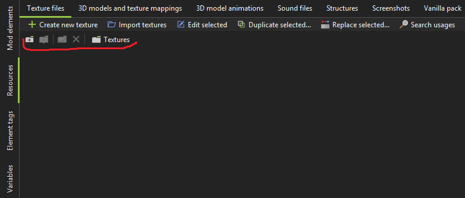

<div align="center">
    
</div>

<h1 align="center">Resource Folders</h1> 

<b>Supported MCreator versions</b>: <code>2026.2</code>

Resource Folders is a MCreator plugin that adds folders to the **Resources**, **Element Tags**, and **Variables** tabs, making it much easier to organize large projects.

Instead of having every texture, model, sound, animation, structure, or screenshot displayed in one long list, you can organize resources, tags, and variables into folders and subfolders directly inside MCreator.

It's completely safe to start using this plugin in already existing workspaces, even to organize resources that are already used by different mod elements.

<i>Requires Java plugins to be enabled</i>

## Features

### Organize every resource category

Each resource category, Element Tags, and Variables has its own independent folder structure.

For example, a `Bosses` folder inside **Textures** is completely separate from a `Bosses` folder inside **Sounds**.

---

### Folders and subfolders

To create a folder you can use the <code>Create button</code> (the one with a <code>+</code> on it) in the Resource Folders menu:

<div align="center">
    
</div>

<br>

Then, you can enter a folder by double-clicking on it. The other buttons are used to: go back, rename and delete.

Create as many folders and nested subfolders as you need.

For example:

```text
Textures
├── Blocks
├── Items
├── UI
└── Entities
    ├── Animals
    ├── NPCs
    └── Bosses
        ├── Final Boss
        └── Minibosses
```


### Import directly into folders

When you import a new resource while inside a folder, Resource Folders automatically places it in the folder you are currently viewing.

For example:

Textures / Entities / Bosses

If you import a new texture there, it will immediately be organized inside Bosses.

No need to import it first and move it afterward.

New tags and variables created while viewing one of their folders are placed there automatically.

### Move resources between folders

Resources can be moved at any time by right-clicking on them and using the <code>Move to folder</code> option or by simply dragging and dropping them into their new location.

You can also select multiple resources and move them together.

Moving a resource back to the main resource category places it in the root folder again.

Tags and variables can also be moved with the context menu or drag and drop. Moving them changes only their folder assignment: tag entries and variable names, types, scopes, and initial values are preserved. Renaming a variable keeps its folder assignment.

### What things are safe to do?

- *Using the plugin in an already existing workspace* - **Safe**

- *Renaming a folder that contains resources used by different mod elements* - **Safe**

- *Moving resources that are used by different mod elements in another folder* - **Safe**

- *Moving tags or variables to another folder* - **Safe; their contents and settings are preserved**

- *Removing the plugin from MCreator after having already used it to organize a workspace's resources* - **Safe** (but will make me a little sad)

- *Deleting a folder that contains resources, tags, or variables* - **Deletes its contents from the workspace after confirmation. Check usage warnings before confirming.**

<br>

<div align="center">
    <b>&copy; bo bo - 2026</b>
</div>
